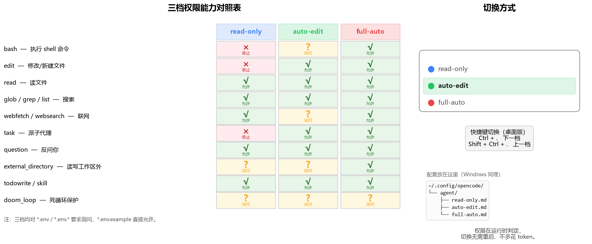

# OpenCode Permission Modes

> 给 [OpenCode](https://opencode.ai) 加上 Codex 风格的三档权限：**read-only / auto-edit / full-auto**。一键切换，零运行时开销。

[](https://github.com/jeeleonard9-art/opencode-permission-modes/actions/workflows/validate.yml)
[](LICENSE)
[](https://opencode.ai)
[]()
[](https://github.com/jeeleonard9-art/opencode-permission-modes/pulls)

**[English](README_EN.md)** · 中文



## 这是什么

OpenCode 内置的 `build` 和 `plan` 两个 agent，切换的是「要不要先写计划」，而不是「我能动多少东西」。想限制 agent 别乱改文件、别擅自跑命令，只能靠每次手动点确认。

这个仓库把权限拆成三个独立的 primary agent，用 OpenCode 原生的 `permission` 配置实现：

| 档位 | 一句话 | 适合场景 |
| --- | --- | --- |
| `read-only` | 只看不改，不跑任何命令 | 读代码、查资料、code review、解释实现 |
| `auto-edit` | 随便改文件，但跑命令/联网要你点头 | 日常开发（**推荐设为默认**） |
| `full-auto` | 全部放行，不再打断你 | 明确的小任务、批量重构、无人值守 |

切换方式就是换一个 agent（桌面版按 `Ctrl + .`），权限**立即生效**：不重启应用、不额外调用模型、不消耗 token。

## 为什么不用插件

实现同样的效果有两条路，我选了后者：

| | 插件（hook 拦截） | **Agent + permission（本仓库）** |
| --- | --- | --- |
| 运行时开销 | 每次工具调用都要过一遍 JS 逻辑 | 判定在进程内查表，**零额外开销** |
| 复杂度 | 需要处理 tool.execute.before 的各种分支 | 纯配置，没有一行可执行代码 |
| 可见性 | 藏在代码里，界面上看不出当前档位 | **直接出现在 agent 选择器里**，当前档位一目了然 |
| 升级风险 | 依赖未公开的内部 API | 只依赖公开的配置 schema |

## 能力对照

| 工具 | read-only | auto-edit | full-auto |
| --- | --- | --- | --- |
| `bash` 执行命令 | 禁止 | 询问 | 允许 |
| `edit` 修改/新建文件 | 禁止 | 允许 | 允许 |
| `read` 读文件 | 允许¹ | 允许¹ | 允许¹ |
| `glob` / `grep` / `list` 搜索 | 允许 | 允许 | 允许 |
| `webfetch` / `websearch` 联网 | 允许 | 询问 | 允许 |
| `task` 派生子代理 | 禁止 | 允许 | 允许 |
| `question` 反问你 | 允许 | 允许 | 允许 |
| `external_directory` 工作区外读写 | 询问 | 询问 | 允许 |
| `todowrite` / `skill` | 允许 | 允许 | 允许 |
| `doom_loop` 死循环保护 | 询问 | 询问 | 询问 |

¹ 三档都会对 `*.env` 和 `*.env.*` 要求确认，`*.env.example` 直接允许——避免 agent 顺手把密钥读进上下文。

## 安装

### 一键脚本

**Windows**

```powershell
git clone https://github.com/jeeleonard9-art/opencode-permission-modes.git
cd opencode-permission-modes
powershell -ExecutionPolicy Bypass -File .\install.ps1
```

**macOS / Linux**

```bash
git clone https://github.com/jeeleonard9-art/opencode-permission-modes.git
cd opencode-permission-modes
chmod +x install.sh && ./install.sh
```

脚本只做两件事：把 `agent/*.md` 复制到配置目录（内容不同的先备份成 `.bak`，完全相同就跳过）；如果配置目录里还没有配置文件，就放一份示例进去。它**不会覆盖**你已有的 `opencode.json`。同时会在配置目录写一个 `.opencode-permission-modes.manifest`，记录装了什么、备份是哪个——卸载脚本靠它还原。

### 卸载

```powershell
# Windows
powershell -ExecutionPolicy Bypass -File .\uninstall.ps1
```

```bash
# macOS / Linux
./uninstall.sh --yes
```

会把三个 `.md` 还原成安装前的样子（没备份过就直接删掉），`opencode.json` 一律不碰；如果 `default_agent` 还指向已删掉的档位，它会给出提示。

### 手动安装

1. 把 `agent/` 下的三个 `.md` 复制到 OpenCode 的配置目录：

   | 系统 | 路径 |
   | --- | --- |
   | Windows | `C:\Users\<你>\.config\opencode\agent\` |
   | macOS / Linux | `~/.config/opencode/agent/` |

2. 想让三档成为唯一的选项、并默认进入 `auto-edit`，在 `opencode.json`（或 `.jsonc`）里加上：

   ```jsonc
   {
     "$schema": "https://opencode.ai/config.json",
     "default_agent": "auto-edit",
     "agent": {
       "build": { "disable": true },
       "plan": { "disable": true }
     }
   }
   ```

   完整示例见 [`examples/opencode.jsonc`](examples/opencode.jsonc)。这一步是可选的——不加也能用，只是 `build` / `plan` 还会留在列表里。

3. 重启 OpenCode（新加的 agent 文件在启动时才会被扫描）。

## 使用

- **桌面版**：输入框上方的 agent 选择器，或按 `Ctrl + .` / `Shift + Ctrl + .` 循环切换。
- **TUI**：`Tab`（取决于你的 `tui.json` 里 `agent_cycle` 的配置）。
- **改默认档**：改 `default_agent`。
- **改快捷键**：设置 → 快捷键 → *Model and agent* 分组。**改完需要重启**才生效。

> Windows 用户注意：`Ctrl + Space` 默认被中文输入法占用（中英切换），所以本项目默认用 `Ctrl + .`。想用 `Ctrl + Space` 的话，在输入法里把这个热键改掉。

## 自定义

**改某一档的权限**：直接编辑对应的 `agent/*.md`，改 `permission` 部分即可。

**加第四档**：复制任意一个 `.md`，改成新的 `name` 和 `permission`，重启后就会出现在选择器里。

**只要两档**：删掉不想要的那个文件。

**给某一档换模型**：在该 `.md` 的 frontmatter 里加 `model: provider/model-id`。

**加固 `full-auto`**：`full-auto` 的 `bash: allow` 意味着什么都能跑。如果想要「其余全放行，但危险命令直接禁用」，把 [`presets/hardened-full-auto.md`](presets/hardened-full-auto.md) 复制进配置目录的 `agent/`（它就会多出一个 `hardened-full-auto` 档），或用它替换 `agent/full-auto.md`。它禁用这几类：

```yaml
    "git push --force*": deny
    "git push -f*": deny
    "rm -rf*": deny
    "git reset --hard*": deny
    "git clean -f*": deny
```

> 注意这是**命令字符串的 glob 匹配**，不是沙箱。`sudo rm -rf`、`cd /tmp && rm -rf x` 这类变体不会命中前缀匹配，需要自己补规则。真正的隔离请用容器或虚拟机。

## 工作原理

三个 agent 都没有内置 system prompt（除了一行说明当前档位），它们的差异**只在 `permission` 字段**。OpenCode 在每次工具调用前用这份配置做一次本地判定：命中 `deny` 的工具会直接从模型可用的工具列表里移除，`ask` 会弹确认，`allow` 直接放行。

判定规则是「**最后一条匹配的规则获胜**」，没有匹配时默认 `ask`。另外有一个容易踩的坑：自定义 agent 的 `question` 权限默认是 `deny`，所以本仓库三档里都显式写了 `question: allow`。

细节和踩坑记录见 [`docs/how-it-works.md`](docs/how-it-works.md) 与 [`docs/faq.md`](docs/faq.md)。

## 兼容性

- 在 **OpenCode Desktop 1.19.3（Windows）** 上开发和验证。
- 只使用公开配置字段（`agent.*.permission`、`default_agent`、`agent.*.disable`），TUI 与桌面版通用。
- 没有依赖，没有构建步骤，没有可执行代码。
- CI 在 Ubuntu / macOS / Windows 上校验配置 schema、解析 frontmatter、检查文档链接，并跑一遍安装→重装→卸载的往返测试。

完整的验证矩阵（版本 × 平台 × 形态）、已知的版本敏感点和自查清单见 [`docs/compatibility.md`](docs/compatibility.md)。

## 已知限制

- 新增/删除 agent 文件需要重启应用（改已有档位的权限不需要）。标准操作流见 [`docs/faq.md`](docs/faq.md#新增删除档位为什么要重启)。
- `read-only` 档禁止 `task`，因此它不能派生子代理；这是刻意的——子代理会继承另一套权限，容易绕过限制。
- 这是一个「策略」而不是「沙箱」：`full-auto` 档的 `bash: allow` 意味着 agent 能执行任意命令。请只在你信任的环境里使用。

## 反馈与维护

- **遇到 bug**：走 [issue 模板](https://github.com/jeeleonard9-art/opencode-permission-modes/issues/new/choose)。模板会要求填 OpenCode 版本、系统、形态和复现步骤——缺一样基本就得多来回一轮。
- **用法问题、想法讨论**：去 [Discussions](https://github.com/jeeleonard9-art/opencode-permission-modes/discussions)，别占 issue 区。
- **想自己改**：先看 [CONTRIBUTING.md](CONTRIBUTING.md)，里面写明这个仓库接受什么、拒绝什么。
- **维护节奏**：跟随 OpenCode 的 `permission` schema 变化更新；每次发版记录在 [CHANGELOG.md](CHANGELOG.md) 并打 tag，验证状态记在 [compatibility.md](docs/compatibility.md)。

改完的配置由 CI 把关：`scripts/validate_config.py`（只用标准库）校验 `permission` 的键与值、`examples/opencode.jsonc` 的可解析性、README 里的相对链接；CI 里还会用真正的 YAML 解析器复查一遍 frontmatter，并跑安装/卸载往返测试。本地也能直接跑：

```bash
python scripts/validate_config.py
```

## 变更记录

见 [`CHANGELOG.md`](CHANGELOG.md)。

## License

[MIT](LICENSE)
